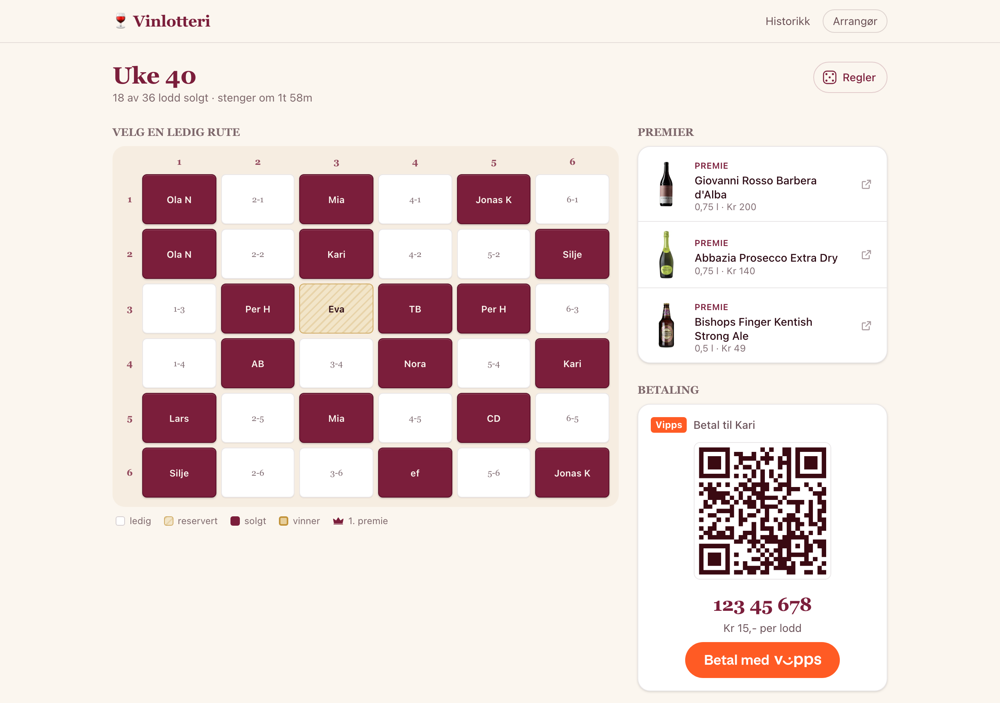
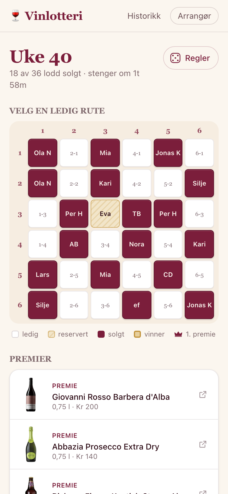
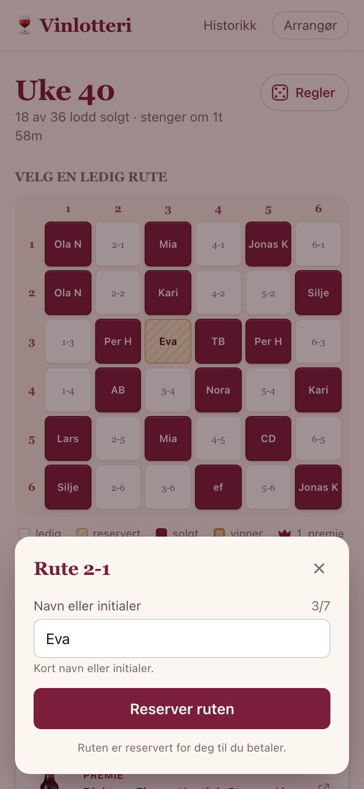
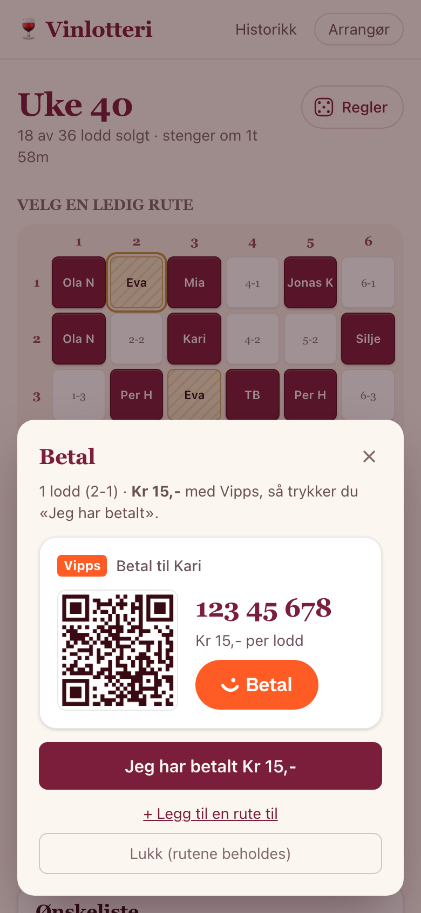
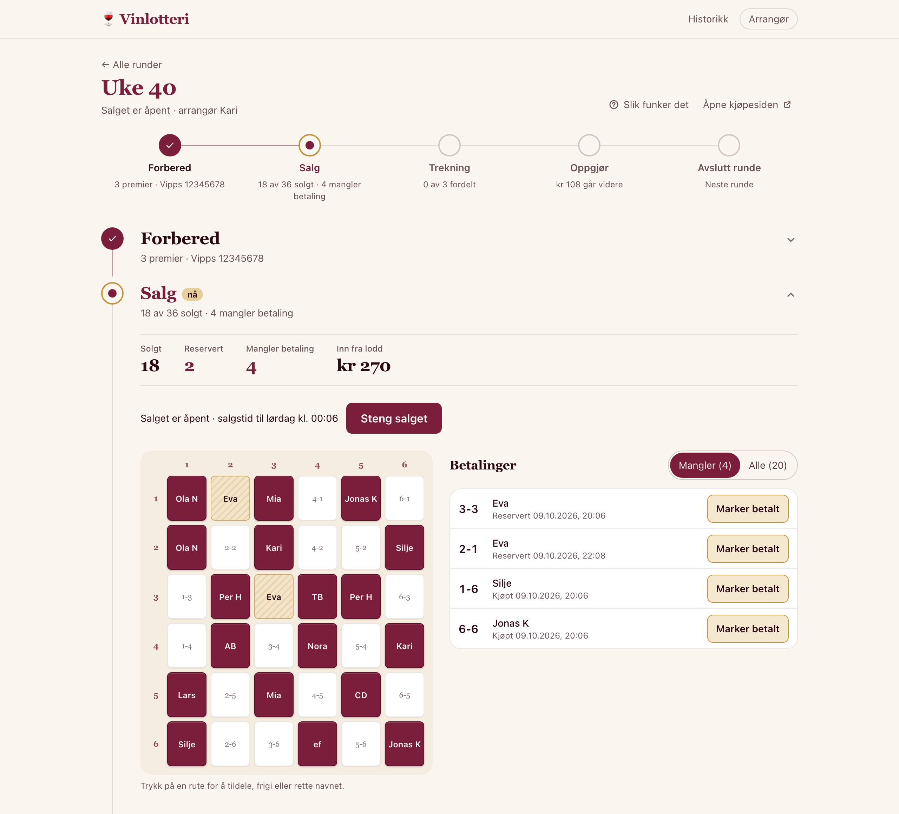
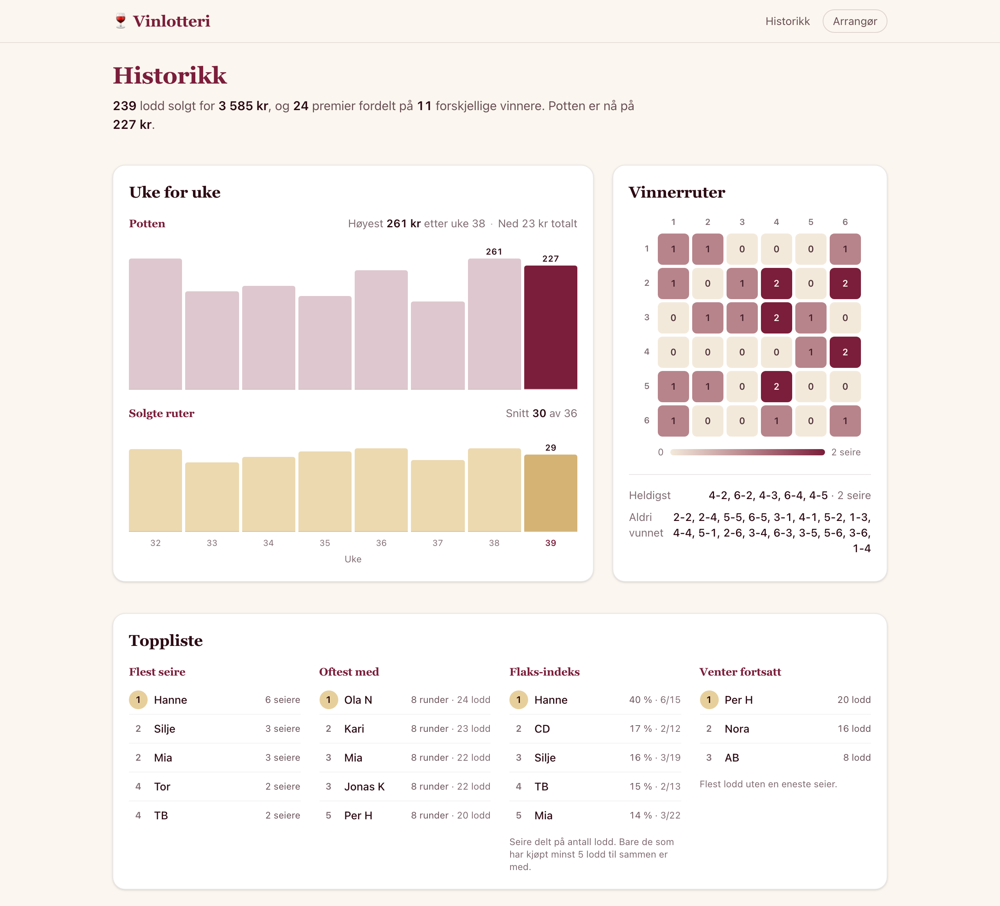

# 🍷 Vinlotteri

Webapp for kollegialt vinlotteri. Erstatter Excel-arket. Man åpner siden på PC eller mobil,
ser premiene, velger en ledig rute, skriver navnet sitt og betaler med Vipps. Arrangøren styrer
runden, huker av betalinger og kjører trekningen.

<p align="center">
  
</p>

## Skjermbilder

Bildene viser anonyme demodata.

**Kjøp på mobil** – velg en ledig rute, skriv navnet ditt og betal med Vipps.

<table>
  <tr>
    <td align="center"><br><sub>1. Velg rute</sub></td>
    <td align="center"><br><sub>2. Skriv navn</sub></td>
    <td align="center"><br><sub>3. Betal med Vipps</sub></td>
  </tr>
</table>

**Arrangør** – følg salget, huk av betalinger, kjør trekningen og gjør opp runden.



**Historikk og statistikk** – potten uke for uke, vinnerruter, toppliste og alle tidligere runder.



## Funksjoner

- **Live rutenett** – ledige/opptatte ruter oppdateres i sanntid (Server-Sent Events).
- **Kjøp uten innlogging** – velg rute, skriv navn/initialer. Etter første rute
  får du valget «legg til en rute til» eller «gå til betaling», og betaler samlet for alle rutene.
- **Profil uten passord** – navnet du kjøper med blir profilen din på enheten (ruta øverst til høyre
  med initialene dine). Velg deg selv fra lista på en annen enhet, så er rutene dine merket der også,
  vinnerlistene viser «Deg!», og historikken viser dine egne tall. Hvem som helst kan velge hvem som
  helst – det er en snarvei, ikke sikkerhet. «Jeg har betalt» og «Angre» virker bare på enheten
  som reserverte ruta.
- **Vipps** – QR + nummer per runde, generert fra Vippsnummeret («Vipps meg»-lenke). Personlig
  Vippsnummer som byttes hver runde (vinner arrangerer neste) – påkrevd for å åpne loddsalget.
- **Premier fra Vinmonopolet** – lim inn URL/varenummer, info hentes automatisk. Med en gratis
  API-nøkkel hentes navnet også. Eller lim inn et skjermbilde fra vinmonopolet.no – med
  `OCR_API_KEY` leses navn, varenummer, pris og volum av med en vision-modell.
- **Trekning** – fysisk terning (tast inn kolonne/rad) *eller* digital trekning med etterprøvbar seed.
- **Pengestats & historikk** – inn fra sist + lodd solgt − kost på polet = videreført, regnes automatisk
  og føres videre til neste runde. Historikk-siden viser også statistikk på tvers av alle runder:
  flest seire, hvem er med oftest, flaks-indeks (seiersprosent), hvem som er uheldigst, og et
  heatmap over hvilke ruter som vinner mest.
- **Én felles tilgangs-PIN** (`SITE_PIN`) låser hele siden. Alle som kommer inn kan også
  administrere – den som vinner arrangerer neste runde.
  Feil PIN bremses: 3. feil fra samme IP gir 5 min sperre, så dobbelt for hver nye feil (maks
  ett døgn), og over 100 feil totalt siste døgn stenger innlogging for alle nye en periode. Gjelder
  også `?k=`. IP leses fra `CF-Connecting-IP`/`X-Real-IP`. Bruk gjerne en PIN på 6+ sifre.
- **Teams-varsler** (valgfritt, `TEAMS_WEBHOOK_URL`) – se under.

## Kjøre lokalt

```bash
npm install
npm run dev              # http://localhost:3000
```

Uten `SITE_PIN` er siden åpen. Sett `SITE_PIN=xxxx` i `.env` for å teste låsen –
da må du innom `/apne` (eller bruke `?k=xxxx` i URL-en) før du slipper inn.

Vil du teste fra mobilen på samme nett, sett `DEV_ORIGINS=<Mac-ens IP>` i `.env` og åpne
`http://<IP>:3000`.

## Tester

```bash
npm test                 # kjør alle tester én gang (Vitest)
npm run test:watch       # kjør på nytt ved endringer
npm run typecheck        # TypeScript-sjekk
```

Testene ligger ved siden av koden som `*.test.ts` (f.eks. `lib/money.test.ts`).
`lib/testFactories.ts` har små byggere for runder, lodd, premier og trekninger.
CI kjører typesjekk og tester på hver push og pull request, og Docker-imaget
publiseres bare når de er grønne.

Krever Node 22+ (bruker innebygd `node:sqlite`). Databasen legges i `./data/vinlotteri.sqlite`.

Valgfritt: `npm run seed` lager en demorunde med premier og noen solgte lodd.

## Importere historikk fra Excel

`Vinlotteri loddark - <år>.xlsx` (ett ark per uke) kan importeres som ferdige runder – rutenett med
navn, arrangør/Vippsnummer, pengestats og vinnere per uke. Pengestatsen kontrolleres mot arket
(`inn + lodd solgt − kost på polet = videreført`).

```bash
npm run import:history                # importer, hopp over uker som alt finnes
npm run import:history -- --force      # erstatt uker som er importert før
npm run import:history -- --all        # ta med uker uten registrerte vinnere (pågående runde)
```

Importen leser `scripts/loddark-<år>.json` (ingen Python trengs). JSON-en inneholder navn og Vippsnumre, så den ligger i `.gitignore` og skal ikke committes.
Uker uten vinnere (typisk inneværende uke) hoppes over så de kan kjøres live i appen i stedet.

Regenerere JSON-en fra et nytt regneark:
```bash
python3 -m venv .venv && .venv/bin/pip install openpyxl
.venv/bin/python scripts/extract-loddark.py "Vinlotteri loddark - 2027.xlsx"
```

Merknader: vinnernavn lagres slik de er skrevet i arket (initialer eller fullt navn); der navnet
matcher en rute i rutenettet kobles vinneren til ruten, ellers vises bare navnet. Premienavn hentes
fra vinnerlinja («1: AB - Rødvin» → premie «Rødvin»), ellers «N. premie».

## Deploy med Docker

Et image bygges og publiseres til GHCR ved hver push til `main`
(`.github/workflows/docker-publish.yml`).

1. **Lag `.env`** ved siden av `docker-compose.yml` (se `.env.example` for alle valg):
   ```env
   SITE_PIN=1234
   APP_URL=https://vinlotteri.example.com
   ```
   `docker compose up` nekter å starte uten `SITE_PIN` (sett `SITE_PIN=off` for å kjøre uten lås).

2. **Start containeren:**
   ```bash
   docker compose pull
   docker compose up -d
   ```
   Er pakken privat, kjør `docker login ghcr.io` først (GitHub-bruker + PAT med `read:packages`).
   Vil du bygge selv: `docker build -t vinlotteri .`

3. **Volum og nettverk:** SQLite-fila ligger i `/data` i containeren – juster volum-mappinga i
   `docker-compose.yml` til der du vil ha den. Appen lytter på port 3000.

4. **Reverse proxy (HTTPS):** sett appen bak en proxy. Slå av buffering for Server-Sent Events,
   ellers oppdateres ikke rutenettet live. `deploy/vinlotteri.subdomain.conf` er et eksempel for nginx.

5. Åpne `APP_URL`, tast `SITE_PIN`. Del gjerne en magisk lenke – `<APP_URL>/runde/<id>?k=<PIN>` –
   så slipper folk å taste.

## Slik kjører dere en runde

1. **`/admin` → Ny runde.** Fyll inn tittel, pris, arrangørens navn + Vippsnummer, tidspunkt for
   når maks-grensen oppheves og når salget stenger. Velg trekningsmåte. Sett «inn fra forrige runde».
2. **Premier:** lim inn varenummer fra vinmonopolet.no, «Hent», juster, «Legg til».
3. **Åpne loddsalg.** Del QR-en / lenka til runden (`/runde/<id>`).
4. **Salg-fanen:** følg med, marker betalinger etter hvert som Vipps kommer inn. «Steng salg» før trekning.
5. **Trekning-fanen:** kast terningen fysisk og tast inn kolonne/rad, eller trykk «Trekk vinner» for
   digital trekning. Tom rute → kast på nytt. Vinnerlista på rundesiden oppdateres live.
6. **Oppgjør-fanen:** sjekk tallene, «Gjør opp runden», så «Start neste runde». Den nye runden fylles
   automatisk ut: tittel = kommende fredags ukenummer, maks-grense oppheves fredag 14:30, loddsalg
   stenger fredag 15:00, saldoen føres videre, og arrangør settes til 1. premie-vinneren (Vippsnummeret
   må du fylle inn selv – det er ikke lagret noe sted). Alt kan justeres i Innstillinger-fanen før du
   åpner salget.

## Teams-varsler

Sett `TEAMS_WEBHOOK_URL` i `.env` for å poste til en Teams-kanal. Lag URL-en i Teams: kanalen →
**…** → **Workflows** → «Post to a channel when a webhook request is received». Flere kanaler:
kommaseparer URL-ene. Lenkene i meldingene bygges fra `APP_URL` (uten PIN).

Appen poster når:

- **loddsalget åpner** – arrangør og premier
- **salget stenger om 1 time** – solgte/ledige lodd og pott (flyttes stengetiden, kommer det et nytt varsel)
- **alle vinnere er trukket** – vinnerliste med rute og valgt premie, hvem som arrangerer neste runde, hvor mye som vippses videre, og en påminnelse om å avslutte runden

Hver melding sendes bare én gang per runde (lagret i tabellen `notifications`), også om du angrer
og gjør noe på nytt. Tidsstyrte varsler sjekkes hvert minutt fra `instrumentation.ts`.

## Om Vipps

Med et **privat Vippsnummer** kan appen bare vise QR/nummer – beløp kan ikke forhåndsfylles og det
finnes ingen automatisk betalingsbekreftelse. Arrangøren huker av betalinger manuelt i Salg-fanen.
Full automatikk (forhåndsfylt beløp + webhook) krever Vipps bedriftsavtale og er ikke bygget inn.

## Teknisk

Next.js 16 (App Router) · innebygd `node:sqlite` · Tailwind v4 · SSE for sanntid.

Eksterne tjenester: Vinmonopolets offentlige bilde-URL-er (alltid), og valgfritt Vinmonopolets API
(`VINMONOPOLET_API_KEY`), en OpenAI-kompatibel vision-modell for skjermbilder (`OCR_API_KEY`,
standard OpenRouter) og Teams-webhooks (`TEAMS_WEBHOOK_URL`).
