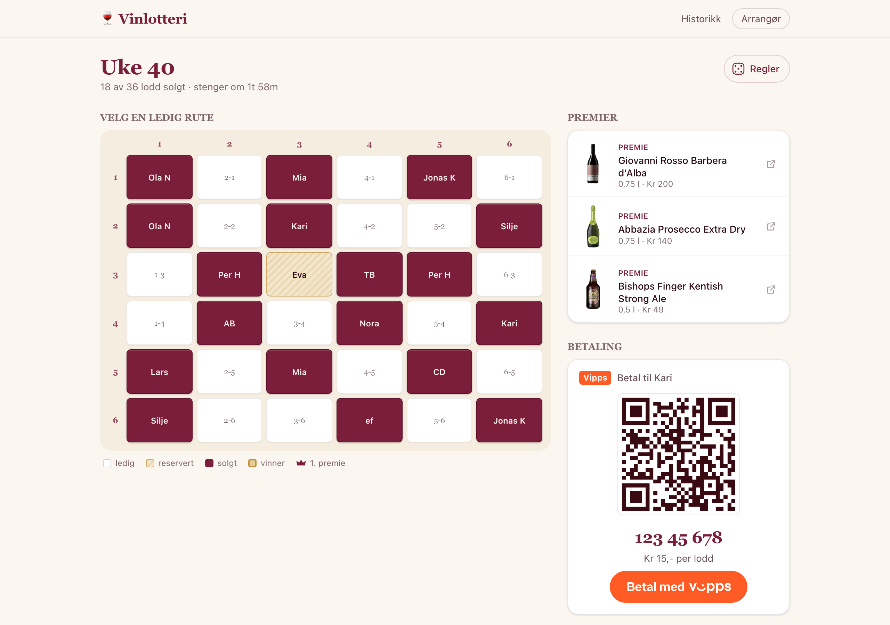
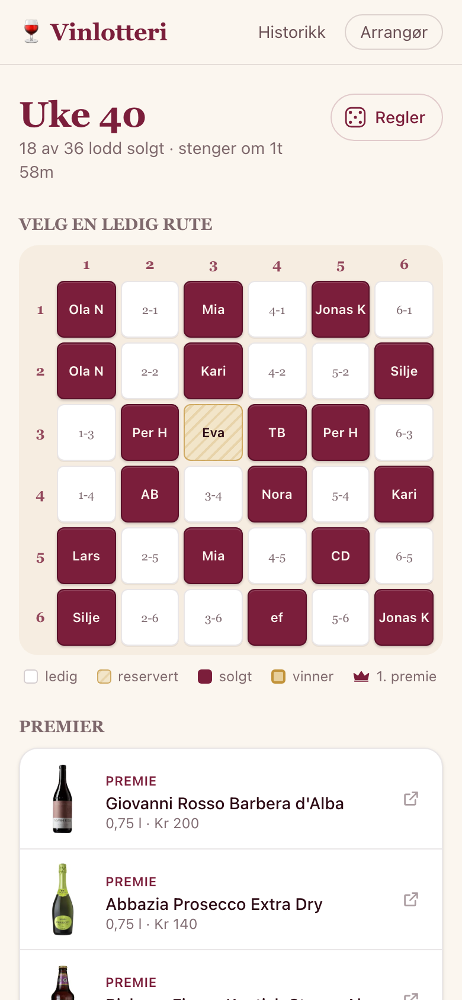
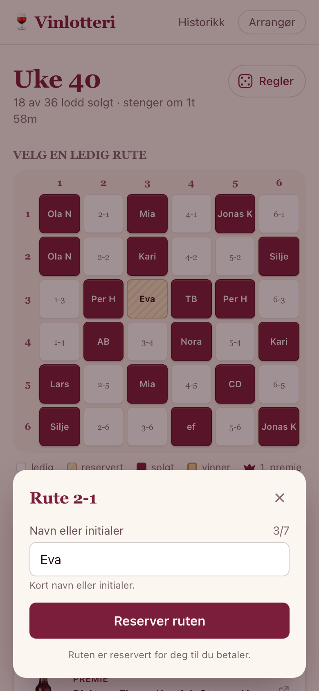
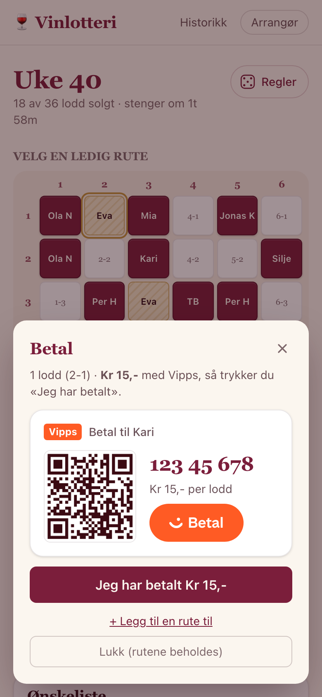
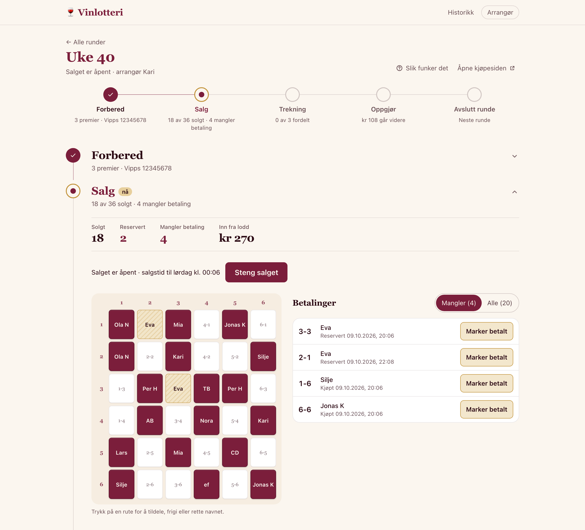
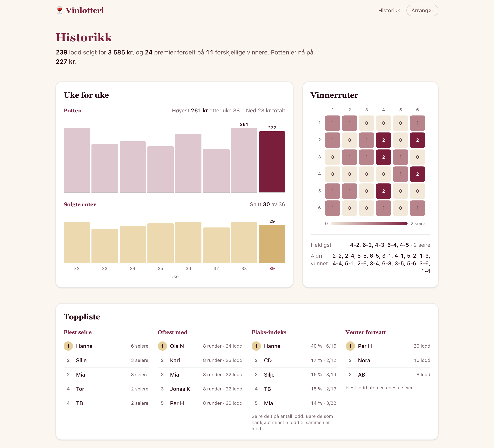

<div align="center">


# Vinlotteri

**Kollegialt vinlotteri på nett. Velg en rute, skriv navnet ditt, betal med Vipps.**

[](https://github.com/janfredrik/vinlotteri/actions/workflows/ci.yml)
[](https://github.com/janfredrik/vinlotteri/actions/workflows/docker-publish.yml)
[](https://nodejs.org)
[](https://nextjs.org)
[](LICENSE)

[Funksjoner](#funksjoner) • [Kom i gang](#kom-i-gang) • [Drift med Docker](#drift-med-docker) • [Slik kjører dere en runde](#slik-kjører-dere-en-runde)

</div>

Vinlotteri erstatter Excel-arket på kontoret. Kollegaer åpner siden på PC eller mobil, ser premiene, velger en ledig rute i et 6×6-rutenett og betaler arrangøren med Vipps. Arrangøren styrer runden, huker av betalinger, kjører trekningen og gjør opp. Pengene føres videre automatisk, og historikken bygger seg selv.

<p align="center">
  
</p>

> [!NOTE]
> Dette er et selvhostet verktøy for én arbeidsplass, ikke et produkt. Det kjenner reglene til akkurat dette lotteriet: ruter vises som kolonne-rad, vinneren av 1. premie arrangerer neste runde, og regnskapet `inn + lodd solgt − kost på polet = videreført` går alltid opp.

## Skjermbilder

Bildene viser anonyme demodata.

**Kjøp på mobil.** Velg en ledig rute, skriv navnet ditt og betal med Vipps.

<table>
  <tr>
    <td align="center"><br><sub>1. Velg rute</sub></td>
    <td align="center"><br><sub>2. Skriv navn</sub></td>
    <td align="center"><br><sub>3. Betal med Vipps</sub></td>
  </tr>
</table>

**Arrangør.** Følg salget, huk av betalinger, kjør trekningen og gjør opp runden.



**Historikk og statistikk.** Potten uke for uke, vinnerruter, toppliste og alle tidligere runder.



## Funksjoner

- **Live rutenett.** Ledige og solgte ruter oppdateres i sanntid med Server-Sent Events.
- **Kjøp uten innlogging.** Velg rute og skriv navn eller initialer. Legg til flere ruter og betal samlet for alle.
- **Profil uten passord.** Navnet du kjøper med blir profilen din på enheten. Velg deg selv på en annen enhet, så er rutene dine merket der også, vinnerlistene viser «Deg!» og historikken viser dine tall. Det er en snarvei, ikke sikkerhet: «Jeg har betalt» og «Angre» virker bare på enheten som reserverte ruta.
- **Vipps.** QR-kode og «Vipps meg»-lenke lages fra arrangørens personlige Vippsnummer, som byttes hver runde.
- **Premier fra Vinmonopolet.** Lim inn URL eller varenummer, så hentes bilde (og navn med API-nøkkel). Eller lim inn et skjermbilde fra vinmonopolet.no og la en vision-modell lese av navn, varenummer, pris og volum.
- **Trekning.** Fysisk terning der arrangøren taster inn kolonne og rad, eller digital trekning med etterprøvbar seed. Storskjermen (`/runde/<id>/skjerm`) følger hver terning live på TV eller prosjektor.
- **Regnskap og historikk.** Potten regnes ut og føres videre til neste runde. Historikken viser flest premier, hvem som er med oftest, flaks-indeks, hvem som er uheldigst og et heatmap over vinnerruter.
- **Årgang.** Året oppsummert som en story, sluppet av superadmin.
- **Endringslogg.** Hver admin-handling, reservasjon og betalingsbekreftelse logges med tid, profilnavn og IP, per runde og samlet på `/admin/logg`.
- **Teams-varsler.** Valgfrie meldinger når salget åpner, før det stenger og når vinnerne er trukket.
- **Sesongtema og Excel-modus.** Jul, påske og halloween for kjøpssiden, og `/unc` viser runden som det gamle regnearket.

## Kom i gang

### Forutsetninger

- [Node.js](https://nodejs.org) 22 eller nyere (appen bruker innebygde `node:sqlite`; CI og Docker bruker 24)
- [Docker](https://www.docker.com) for produksjon (valgfritt lokalt)

### Kjøre lokalt

```bash
npm install
npm run seed   # valgfritt: lager en demorunde med premier og noen solgte lodd
npm run dev    # http://localhost:3000
```

Databasen legges i `./data/vinlotteri.sqlite`. Uten `SITE_PIN` i `.env` er siden åpen. Sett `SITE_PIN=1234` for å teste låsen, så må du innom `/apne` eller bruke `?k=1234` i URL-en.

> [!TIP]
> Vil du teste fra mobilen på samme nett, sett `DEV_ORIGINS=<Mac-ens IP>` i `.env` og åpne `http://<IP>:3000`.

### Tester

```bash
npm test            # Vitest, én gang
npm run test:watch  # Vitest, ved endringer
npm run typecheck   # TypeScript
npm run test:e2e    # Playwright: kjøpsflyten ende til ende
```

Enhetstestene ligger ved siden av koden som `lib/*.test.ts`, og `lib/testFactories.ts` har byggere for runder, lodd, premier og trekninger. E2E-testen bygger appen og kjører den på port 3100 med egen database i `.e2e/data`. Den kjøper ruter på desktop og mobil, sjekker at en kollega ser det live, at to ikke kan ta samme rute, og at kjøpet havner i endringsloggen. Dev-serveren kan gå samtidig.

CI kjører typesjekk, tester og e2e på hver push og pull request. Docker-imaget publiseres bare når alt er grønt.

## Konfigurasjon

Alt settes i `.env`. Se [`.env.example`](.env.example) for kommentarer.

| Variabel | Beskrivelse |
| --- | --- |
| `SITE_PIN` | Felles PIN som låser hele siden. Alle som kommer forbi kan administrere. Påkrevd i Docker (`off` slår av låsen). |
| `APP_URL` | Offentlig adresse, brukt i lenker, QR-plakat og Teams-meldinger. |
| `SUPERADMIN_PIN` | Egen PIN for `/superadmin`. Tom betyr at siden er stengt. |
| `VINMONOPOLET_API_KEY` | Gratis nøkkel fra [api.vinmonopolet.no](https://api.vinmonopolet.no) som fyller inn premienavnet. Bilder virker uten. |
| `OCR_API_KEY` | Nøkkel til en OpenAI-kompatibel vision-modell som leser skjermbilder av premier. `OCR_BASE_URL` og `OCR_MODEL` er valgfrie (standard OpenRouter). |
| `TEAMS_WEBHOOK_URL` | Én eller flere kommaseparerte Teams-webhooks. |
| `TZ` | Tidssone, standard `Europe/Oslo`. |
| `DEV_ORIGINS` | Bare for utvikling: IP-er som får bruke `npm run dev` fra andre enheter. |

> [!IMPORTANT]
> Feil PIN bremses per IP: 3. feil gir 5 minutters sperre, deretter dobbelt for hver nye feil (maks ett døgn). Over 100 feil totalt siste døgn stenger innlogging for alle nye en periode. Dette gjelder også `?k=`. Bruk gjerne en PIN på 6 sifre eller mer.

`/superadmin` er for den som driver lotteriet: slippe Årgang, rydde i navn og slå på retting av historikk.

## Drift med Docker

Et image bygges og publiseres til GHCR ved hver push til `main` ([`docker-publish.yml`](.github/workflows/docker-publish.yml)).

1. Lag `.env` ved siden av [`docker-compose.yml`](docker-compose.yml):

   ```env
   SITE_PIN=123456
   APP_URL=https://vinlotteri.example.com
   ```

2. Start containeren:

   ```bash
   docker compose pull
   docker compose up -d
   ```

   Er pakken privat, kjør `docker login ghcr.io` først (GitHub-bruker og en PAT med `read:packages`). Vil du bygge selv: `docker build -t vinlotteri .`

3. SQLite-fila ligger i `/data` i containeren. Juster volumet i `docker-compose.yml`. Appen lytter på port 3000.

4. Sett appen bak en reverse proxy med HTTPS. [`deploy/vinlotteri.subdomain.conf`](deploy/vinlotteri.subdomain.conf) er et eksempel for nginx/SWAG.

5. Åpne `APP_URL` og tast PIN-en. Del gjerne en magisk lenke, `<APP_URL>/runde/<id>?k=<PIN>`, så slipper folk å taste.

> [!WARNING]
> Slå av buffering for Server-Sent Events i proxyen, ellers oppdateres ikke rutenettet live.

## Slik kjører dere en runde

1. **Ny runde.** I `/admin`: fyll inn tittel, pris, arrangør og Vippsnummer, når maks-grensen oppheves og når salget stenger. Velg trekningsmåte og sett «inn fra forrige runde».
2. **Premier.** Lim inn varenummer fra vinmonopolet.no, trykk «Hent», juster og «Legg til».
3. **Åpne loddsalg.** Del QR-koden eller lenka til runden (`/runde/<id>`).
4. **Salg.** Marker betalinger etter hvert som Vipps kommer inn, og «Steng salg» før trekning.
5. **Trekning.** Kast terningen og tast inn kolonne og rad, eller trykk «Trekk vinner». Tom rute betyr nytt kast. Knappen «Storskjerm» dukker opp på rundesiden fem minutter før salget stenger. Klikk «Slå på lyd» én gang på skjermen.
6. **Oppgjør.** Sjekk tallene, «Gjør opp runden» og «Start neste runde». Den nye runden får kommende fredags ukenummer, maks-grense fredag 14:30, salgsstopp fredag 15:00, saldoen ført videre og 1. premie-vinneren som arrangør. Vippsnummeret fyller du inn selv, siden det ikke lagres.

### Teams-varsler

Lag webhook-URL-en i Teams: kanalen → **…** → **Workflows** → «Post to a channel when a webhook request is received». Appen poster når:

- loddsalget åpner, med arrangør og premier
- det er én time til salget stenger, med solgte lodd og pott
- klokka er 11 på stengedagen og under halvparten er solgt (ikke hvis salget stenger før 12)
- alle vinnere er trukket, med vinnerliste, neste arrangør og beløpet som vippses videre

Hver melding sendes bare én gang per runde (tabellen `notifications`). Tidsstyrte varsler sjekkes hvert minutt fra `instrumentation.ts`.

## Om Vipps

> [!IMPORTANT]
> Med et privat Vippsnummer kan appen bare vise QR-kode og nummer. Beløp kan ikke forhåndsfylles, og det finnes ingen automatisk betalingsbekreftelse, så arrangøren huker av betalinger i Salg-fanen. Full automatikk krever bedriftsavtale med Vipps og er ikke bygget inn.

## Importere historikk fra Excel

Gamle `Vinlotteri loddark - <år>.xlsx` (ett ark per uke) kan importeres som ferdige runder med rutenett, arrangør, pengestats og vinnere. Regnskapet kontrolleres mot arket.

```bash
# Lag JSON fra regnearket
python3 -m venv .venv && .venv/bin/pip install openpyxl
.venv/bin/python scripts/extract-loddark.py "Vinlotteri loddark - 2027.xlsx"

# Importer
npm run import:history                                # alle år, hopper over uker som finnes
npm run import:history -- scripts/loddark-2025.json   # bare ett år
npm run import:history -- --force                     # erstatt uker som er importert før
npm run import:history -- --all                       # ta med uker uten vinnere
```

Importen advarer før den skriver om «inn» ikke er lik forrige ukes «videreført», eller om antall navn ikke stemmer med «lodd solgt». Uker uten vinnere hoppes over så de kan kjøres live i appen.

> [!CAUTION]
> `scripts/loddark-*.json` inneholder ekte navn og Vippsnumre. Fila ligger i `.gitignore` og skal aldri committes, siden repoet er offentlig.

<details>
<summary><strong>Rette premier og vinnerruter i ettertid</strong></summary>

Vinnere fra arket har ofte bare navn. Slå på «Rette historikk» i `/superadmin`, så viser «Tidligere runder» i `/admin` hvor mange vinnere som mangler rute. Under «Trekning» i en avsluttet runde trykker du «Rett rute» og velger ruten. Under «Forbered» kan du rette tittel, arrangør, Vippsnummer og premier, og under «Salg» kjøpernes navn.

Penger og premievalg endres ikke. Mangler runden kost på polet, låses den til dagens sum før første pris rettes. Slå bryteren av igjen når du er ferdig, og merk at `import:history --force` overskriver rettelsene for ukene den importerer på nytt.

</details>

## Teknisk

[Next.js 16](https://nextjs.org) (App Router) · React 19 · innebygde `node:sqlite` · [Tailwind CSS 4](https://tailwindcss.com) · Server-Sent Events · Vitest og Playwright

| Mappe | Innhold |
| --- | --- |
| `app/` | Sider og API-ruter: `/runde/[id]`, `/historikk`, `/admin`, `/superadmin`, `/wrapped` |
| `components/` | Rutenett, kjøpsflyt, storskjerm og admin-visningene |
| `lib/` | Domenelogikk (penger, trekning, faser), database, varsler og tester |
| `scripts/` | Seed og import fra Excel |
| `e2e/` | Playwright-test av kjøpsflyten |

Eksterne tjenester: Vinmonopolets offentlige bilde-URL-er (alltid), og valgfritt Vinmonopolets API, en vision-modell for skjermbilder og Teams-webhooks. Se [`PRODUCT.md`](PRODUCT.md) for brukere og prinsipper og [`DESIGN.md`](DESIGN.md) for det visuelle.
